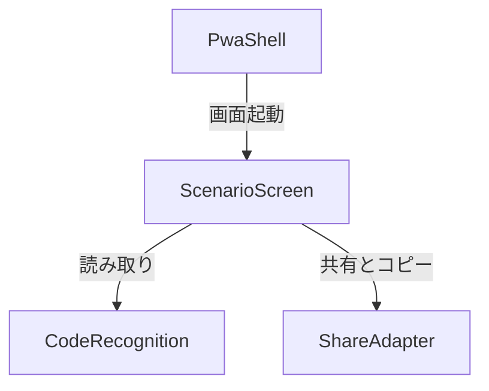

# 構成要素

入力: [要件](../requirements-analysis/requirements.md)、[ストーリー](../user-stories/stories.md)、[開発方針](../practices-discovery/team-practices.md)、[設計回答](domain-design-questions.md)。

```yaml
components:
  - name: ScenarioScreen
    summary: 画像選択から結果表示と共有操作までを管理する
    behaviour: >
      一時的な画像と結果を保持し、選び直しで結果を破棄する。
      古い処理の完了を無視し、状態と警告を表示する。
    responsibilities:
      - 操作状態と画面表示
      - 選択中の画像と結果の所有
    depends_on:
      - component: CodeRecognition
        interaction: 選択画像からコード候補を取得する
        style: async
      - component: ShareAdapter
        interaction: 画像と結果を共有またはコピーする
        style: async
    dependents:
      - component: PwaShell
        interaction: アプリの画面を起動する
    entities:
      - name: ReadingSession
        identifier: selectionId
        attributes: [selectionId, image, status, candidate, formatStatus]
  - name: CodeRecognition
    summary: 画像からコード候補を読み取って形式を判定する
    behaviour: >
      読み取りを非同期に行い、空結果と形式不一致を区別する。
      対象画面のコード表示領域を抽出し、その領域の文字から候補を作る。
      準備データの取得失敗を呼び出し元に伝え、再試行を可能にする。
    responsibilities:
      - 文字認識と候補の形式判定
    depends_on: []
    dependents:
      - component: ScenarioScreen
        interaction: 選択画像からコード候補を取得する
    external_dependencies:
      - name: Tesseract.js
        kind: other
        purpose: ブラウザ内の文字認識
    entities: []
  - name: PwaShell
    summary: アプリの起動とインストールに必要な資源を提供する
    behaviour: >
      アプリのエントリーポイント、マニフェストとアイコンを所有し、
      インストール後も同じ画面を起動する。
    responsibilities:
      - PWA の資源とインストール設定
      - ScenarioScreen の起動
    depends_on:
      - component: ScenarioScreen
        interaction: アプリの画面を起動する
        style: sync
    dependents: []
    entities: []
  - name: ShareAdapter
    summary: 共有とコピーの利用可否を判断し操作する
    behaviour: >
      画像とコードの共有を試み、非対応時にコピーを提供する。
      キャンセルと失敗を区別して呼び出し元に返す。
    responsibilities:
      - 共有とコピーのブラウザ機能の呼び出し
    depends_on: []
    dependents:
      - component: ScenarioScreen
        interaction: 画像と結果を共有またはコピーする
    external_dependencies:
      - name: Web Share API and Clipboard API
        kind: other
        purpose: 端末の共有機能とコードのコピー
    entities: []
```

## Component Diagram



<!-- Text fallback: PwaShell は ScenarioScreen を起動し、ScenarioScreen は CodeRecognition と ShareAdapter を呼び出す。 -->

## Component Summary

| Component | Purpose | Depends On | Dependents | Entities Owned |
| --- | --- | --- | --- | --- |
| ScenarioScreen | 操作と一時状態 | CodeRecognition, ShareAdapter | PwaShell | ReadingSession |
| CodeRecognition | 候補の認識と判定 | なし | ScenarioScreen | なし |
| ShareAdapter | 共有とコピー | なし | ScenarioScreen | なし |
| PwaShell | 起動と PWA の資源 | ScenarioScreen | なし | なし |

## Entity Ownership

| Entity | Owning Component | Identifier | Attributes | References |
| --- | --- | --- | --- | --- |
| ReadingSession | ScenarioScreen | selectionId | image, status, candidate, formatStatus | なし |

## External Dependencies

| Component | Dependency | Kind | Purpose |
| --- | --- | --- | --- |
| CodeRecognition | Tesseract.js | other | 文字認識 |
| ShareAdapter | Web Share API and Clipboard API | other | 共有・コピー |

## Rationale

画面と一時状態、文字認識、共有は別々の責務と失敗条件を持ち、独立して検証しやすい。PwaShell は導入資源と起動の責務を持つ。代替案は一つの部品にまとめる方式で、初期の接続は単純だが責務とテストが混在する。利用者は分離を選択した。

## 読み取り候補の抽出

加工されていない対象スクリーンショットのコード表示領域を画像サイズに応じて切り出し、その領域を OCR に渡す。領域の OCR で文字がまったく得られない場合は失敗とし、文字が得られた場合は候補として表示する。候補が指定の正規表現に一致しなければ警告付きで表示・共有できる。形式一致は正しい認識の保証ではない。

提供された `tests/fixtures/SHQ4-PVS6-ALNL-VA6D.jpg` は 1920×1080 で、コード `SHQ4-PVS6-ALNL-VA6D` が右下に表示されている。目視による初期の切り出し候補は x=1480–1855、y=900–950（元画像の左上を原点）で、相対範囲は約 x=0.771–0.966、y=0.833–0.880。文字全体に余白を含める候補であり、OCR の実行結果では検証していない。実装時にこの画像と正解コードを用いて領域・前処理を確認し、空の認識結果と形式不一致の候補でも各分岐を確認する。他の画面レイアウトや解像度での妥当性は未検証。
